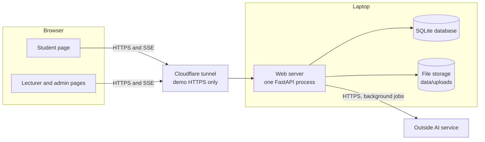
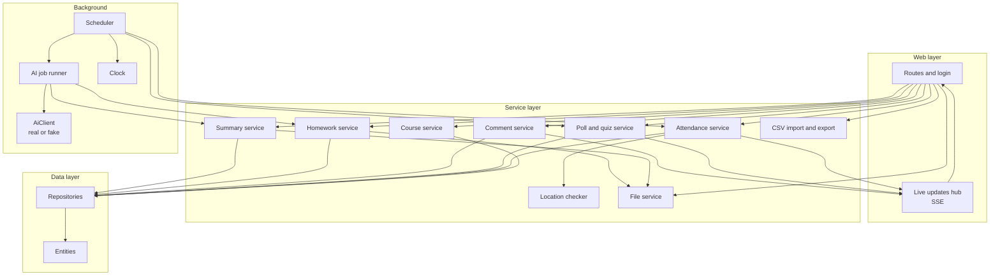

# Main Software Components

**Project:** Smart Classroom Web Application
**Version:** 1.0  |  **Date:** 2026-11-09
**Related:** `SRS_Attendance.md` (v2.1), `UseCases_Attendance.md` (UC1–UC13), `TechStack_Attendance.md` (v2.1)

Two levels: the big blocks that run (section 1), and the modules inside the web server (section 2). Section 3 shows the rules that keep the dependencies simple. The class and sequence diagrams (course item 7) are drawn from section 2.

---

## 1. Level 1: the big blocks

| Block | Job | Technology |
|-------|-----|-----------|
| Student page | Shows spot checks, polls, popped-up comments, summaries, and homework; reads the device location and answers spot checks | Jinja2 page + vanilla JS, `EventSource`, Geolocation API |
| Lecturer and admin pages | Course setup, live attendance table, comments, poll creation, uploads, dataset management | Jinja2 pages + vanilla JS, `EventSource` |
| Web server | All rules and all scheduling in a single process | Python 3.12, FastAPI on Uvicorn |
| Database | Every record in SRS §6; also the only state of the scheduler and of the AI jobs | SQLite (`sqlite3`) |
| File storage | MP4 recordings and homework PDFs, outside the served folder | Local folder |
| Outside AI service | Turns a video into a summary and a homework PDF plus dataset into a review | Provider decided by the tools test |
| Cloudflare tunnel | Gives phones an `https://` address; not part of the product | `cloudflared` |

---

## 2. Level 2: inside the web server

### 2.1 Components

| # | Component | Job | Depends on | Use cases |
|---|-----------|-----|-----------|-----------|
| C1 | Routes and login | Serves pages and endpoints; reads the device token and login id of a student; checks the lecturer login; passes the work to services; refuses unauthenticated or wrong-role requests | Services, live updates hub | all |
| C2 | Live updates hub | Keeps the open SSE connections and pushes events: spot check open, table changed, poll opened or closed, comment received or popped up | none | UC3, UC4, UC5, UC7, UC8, UC9 |
| C3 | Course service | Courses, lectures with their classroom point and radius, enrollment, M / N / window, device registration, device-replacement approval | Repositories | UC1, UC2 |
| C4 | Attendance service | Opens and closes sessions, creates the M hidden spot checks, validates and records responses (token, enrollment, open window, duplicate), computes status when a session closes, applies overrides | Location checker, Repositories, live updates hub | UC3, UC4, UC5 |
| C5 | Location checker | Computes the distance between a reported point and the lecture's point (haversine) and says whether it is inside the radius; keeps no state, stores no coordinates | none | UC3 |
| C6 | Poll and quiz service | Creates polls and quizzes, accepts one vote per student, counts live, hides the correct option until close, closes polls | Repositories, live updates hub | UC8, UC9 |
| C7 | Comment service | Stores comments, links them to the open session, lists them, handles pop-up and dismiss | Repositories, live updates hub | UC6, UC7 |
| C8 | Summary service | Records a lecture video, creates the summary job, stores the result or error, lists previous lectures for students | File service, Repositories | UC10, UC11 |
| C9 | Homework service | Assignments, student submissions, dataset documents with neutral ids, opt-in handling, review storage; sends no data itself | File service, Repositories | UC12, UC13 |
| C10 | File service | Validates type and size, saves to `data/uploads`, returns a file only after an access check (owner, enrolled student, or lecturer); never serves dataset files to students | File storage | UC10, UC11, UC12, UC13 |
| C11 | Scheduler | One loop, once per second, reading everything from the database: opens and closes sessions and spot checks, closes polls at session end, hands pending AI jobs to the job runner | Clock, Attendance service, Poll and quiz service, AI job runner | UC3, UC4, UC8, UC10, UC12 |
| C12 | Clock | The single source of time; a fake clock replaces it in tests | none | UC3, UC4 |
| C13 | AI job runner | Takes a pending job, calls the AiClient with a timeout, writes done or failed with the text or error; never blocks other features | AiClient, Summary service, Homework service | UC10, UC12 |
| C14 | AiClient (real and fake) | `summarize_video(path)` and `review_homework(pdf, dataset)`; the real one calls the provider through `httpx`; the fake returns canned text | Outside AI service | UC10, UC12 |
| C15 | CSV import and export | Checks all rows before saving any; writes `utf-8-sig` exports | Repositories | UC1, UC5 |
| C16 | Repositories | Plain SQL in a few classes (for example `StudentRepository`, `SessionRepository`); the only code that touches SQLite | Entities, database | all |
| C17 | Entities | One `@dataclass` per SRS §6 entity | none | all |

### 2.2 Rules that keep it simple
1. **Layers go downward only:** routes → services → repositories. A repository never calls a service; a service never calls a route.
2. **Only repositories write SQL;** only the file service touches the upload folder; only the AiClient talks to the outside AI service.
3. **The scheduler holds no state in memory.** It re-reads due work from the database every second, so a restart continues the lecture.
4. **Time comes only from the Clock,** never from the device or from `datetime.now()` scattered in services (SOW risk 2).
5. **The AI service is optional at runtime:** if the AiClient fails, only the job fails (NFR-8). Swapping real for fake changes one line.
6. **Student pages never get a secret early:** spot-check times and a quiz's correct option leave the server only at the moment they open or close (NFR-6, FR-8.7).

---

## 3. Where each feature lives

| Feature | Components |
|---------|-----------|
| Attendance | C1, C2, C3, C4, C5, C11, C12, C15, C16, C17 |
| Comments | C1, C2, C7, C16 |
| Polls and quizzes | C1, C2, C6, C11, C16 |
| Lecture summary | C1, C8, C10, C11, C13, C14, C16 |
| Homework review | C1, C9, C10, C11, C13, C14, C16 |

The AI job runner (C13) and the AiClient (C14) are shared by the last two features, so they are built once, in WP9 of the SOW.

## 4. Mapping to work packages

| Work package | Main components |
|--------------|-----------------|
| WP1 | C3 (course part), C15, C16, C17 |
| WP2 | C1 (login), C3 (registration) |
| WP3 | C4 (sessions, spot checks), C11, C12 |
| WP4 | C1, C2, C4 (responses), C5 |
| WP5 | C4 (status, override) |
| WP6 | C1, C2, C15 (export) |
| WP7 | C7 |
| WP8 | C6 |
| WP9 | C8, C10, C13, C14 |
| WP10 | C9, C10 |
| WP11 | all (load, security, privacy checks) |

## 5. Assumptions
- Everything runs in one process on one machine; no separate worker or message queue. **[assumed]**
- Lecturer and administrator are one login (HTTP Basic from environment settings), so no separate accounts component.
