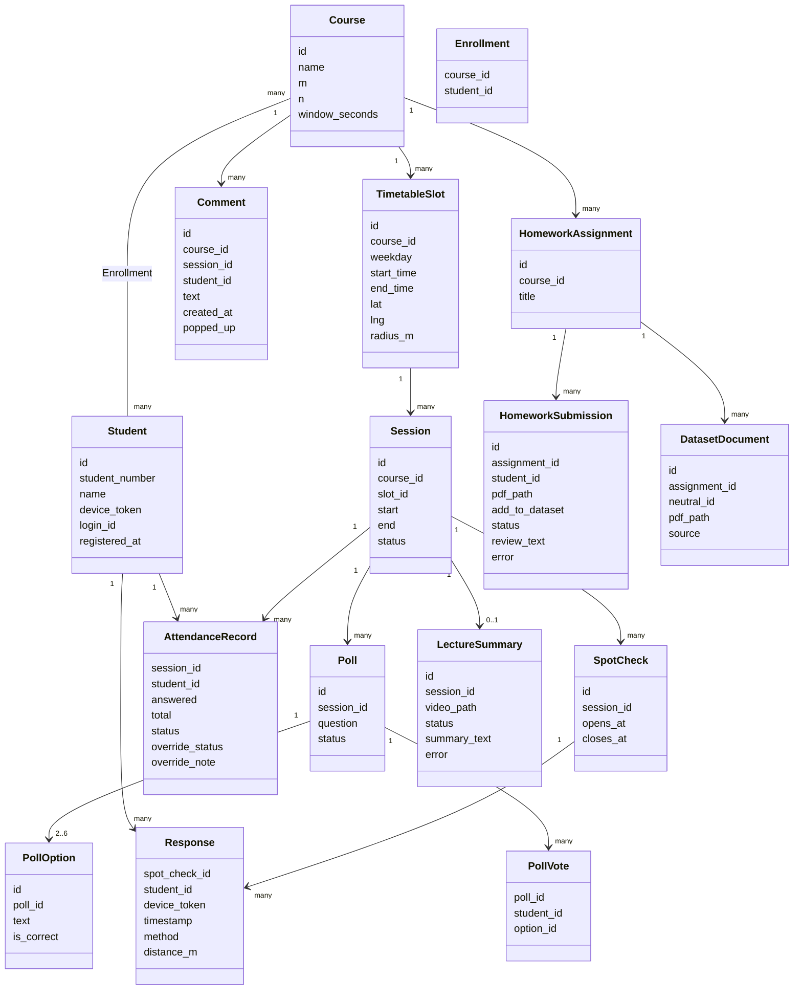
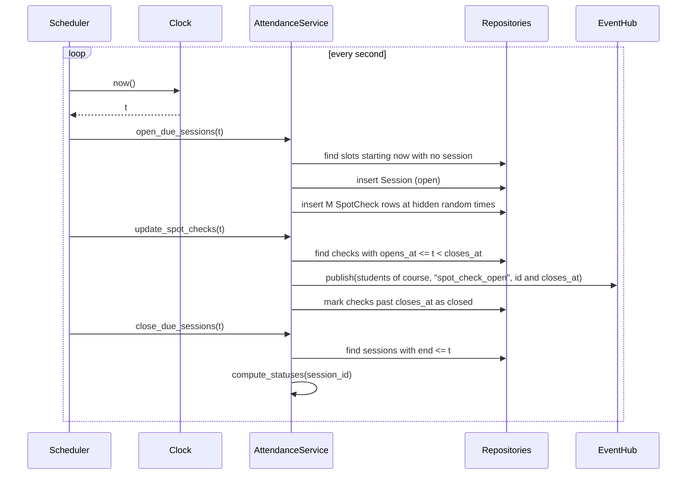
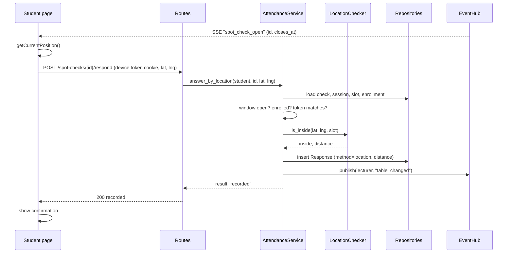
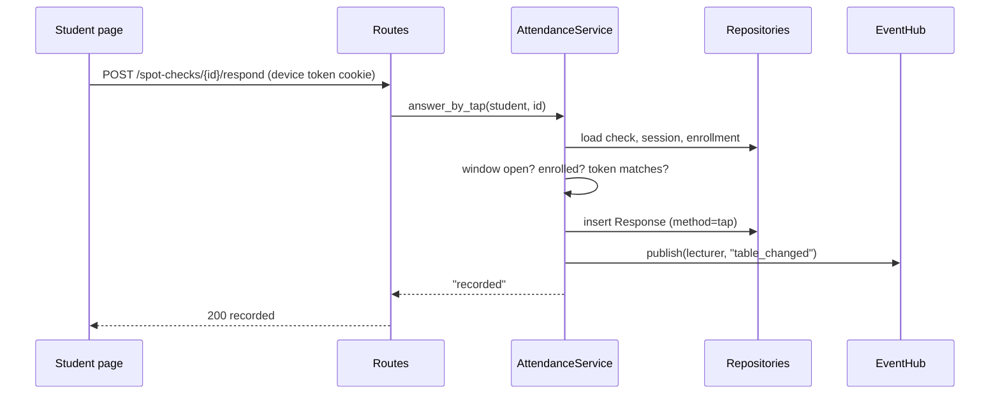
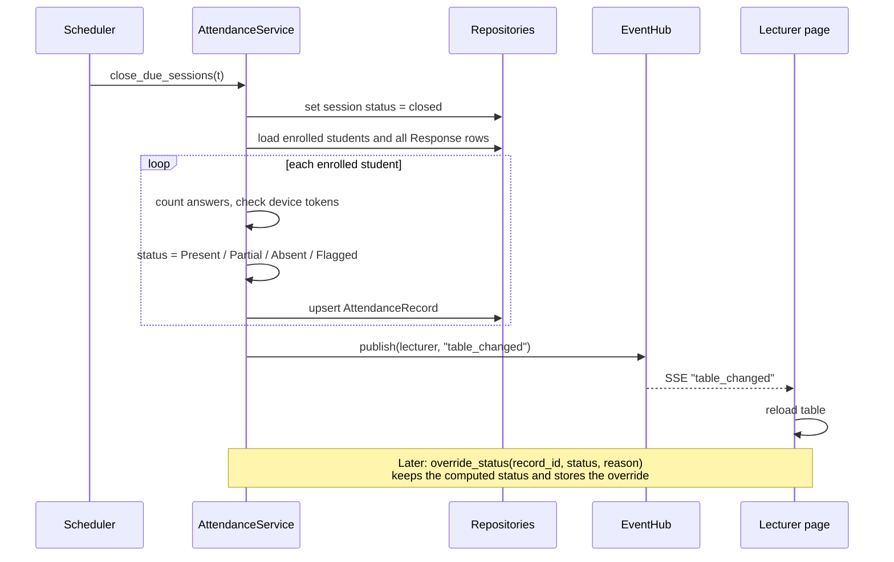
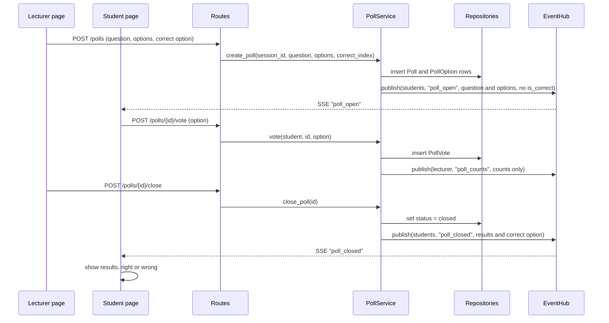
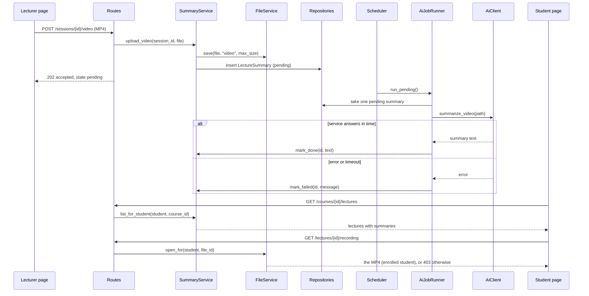
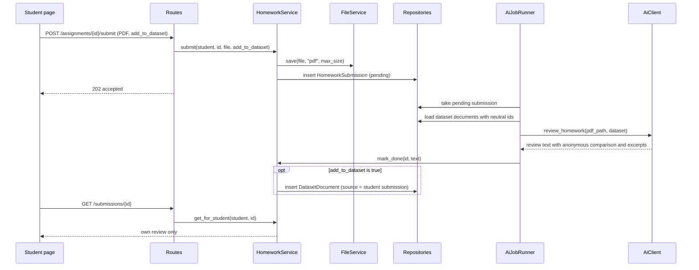

# Low-Level Design: Class and Sequence Diagrams

**Project:** Smart Classroom Web Application
**Version:** 1.0  |  **Date:** 2026-11-09
**Related:** `Components_Attendance.md` (C1–C17), `SRS_Attendance.md` (v2.1), `UseCases_Attendance.md`

Method and field names here are the plan for the code. If the code changes a name, update this file. The class diagrams are the base for the testing strategy (course item 8): every class below gets tests.

Diagrams use Mermaid and render on GitHub and in Obsidian.

---

## 1. Class diagrams

### 1.1 Entities (component C17)

One `@dataclass` per SRS §6 entity. Fields are the plan, not the full schema.

Database rules that back the model: `UNIQUE(spot_check_id, student_id)` on Response, `UNIQUE(poll_id, student_id)` on PollVote, `UNIQUE(device_token)` on Student.

### 1.2 Services and background classes (components C1–C16)

```mermaid
classDiagram
    class Scheduler {
        tick()
        run_forever()
    }
    class Clock {
        now()
    }
    class FakeClock {
        set(time)
        advance(seconds)
    }
    class AttendanceService {
        open_due_sessions(now)
        update_spot_checks(now)
        close_due_sessions(now)
        answer_by_tap(student, spot_check_id)
        answer_by_location(student, spot_check_id, lat, lng)
        compute_statuses(session_id)
        override_status(record_id, status, reason)
        cancel_session(session_id)
    }
    class LocationChecker {
        distance_m(lat1, lng1, lat2, lng2)
        is_inside(lat, lng, slot)
    }
    class CourseService {
        create_course(name, m, n, window)
        add_lecture(course_id, day, start, end, lat, lng, radius)
        import_students(course_id, csv_file)
        register_device(student_number)
        approve_new_device(student_id)
    }
    class PollService {
        create_poll(session_id, question, options, correct_index)
        vote(student, poll_id, option_id)
        close_poll(poll_id)
        close_ended_polls(now)
        counts(poll_id)
    }
    class CommentService {
        send(student, text)
        list(course_id, session_id)
        pop_up(comment_id)
        dismiss(comment_id)
    }
    class SummaryService {
        upload_video(session_id, file)
        mark_done(summary_id, text)
        mark_failed(summary_id, error)
        list_for_student(student, course_id)
    }
    class HomeworkService {
        create_assignment(course_id, title)
        add_dataset_document(assignment_id, file, source)
        submit(student, assignment_id, file, add_to_dataset)
        mark_done(submission_id, text)
        mark_failed(submission_id, error)
    }
    class FileService {
        save(file, kind, max_size)
        open_for(user, file_id)
    }
    class AiJobRunner {
        run_pending()
    }
    class AiClient {
        <<interface>>
        summarize_video(path)
        review_homework(pdf_path, dataset)
    }
    class RealAiClient
    class FakeAiClient
    class EventHub {
        subscribe(audience)
        publish(audience, event)
    }
    class CsvService {
        parse_students(file)
        export_session(session_id)
        export_course(course_id)
    }
    class Repository {
        <<SQL only>>
        get / insert / update / query
    }

    Scheduler --> Clock
    Scheduler --> AttendanceService
    Scheduler --> PollService
    Scheduler --> AiJobRunner
    FakeClock --|> Clock
    AttendanceService --> LocationChecker
    AttendanceService --> EventHub
    AttendanceService --> Repository
    PollService --> EventHub
    PollService --> Repository
    CommentService --> EventHub
    CommentService --> Repository
    CourseService --> Repository
    CourseService --> CsvService
    SummaryService --> FileService
    SummaryService --> Repository
    HomeworkService --> FileService
    HomeworkService --> Repository
    AiJobRunner --> AiClient
    AiJobRunner --> SummaryService
    AiJobRunner --> HomeworkService
    RealAiClient ..|> AiClient
    FakeAiClient ..|> AiClient
```

The Routes (C1) call only the services; they hold no rules. There is one repository class per entity group (`StudentRepository`, `SessionRepository`, and so on); the diagram shows them as one box.

**Key design decisions**
1. `AttendanceService` has two entry points, `answer_by_tap` and `answer_by_location`. Both end in one private check (token, enrollment, open window, duplicate), so the rules cannot drift apart.
2. `LocationChecker` has no state and no repository. It can be tested with plain numbers.
3. `Scheduler.tick()` takes the time from `Clock` only. Tests give it a `FakeClock`. `AttendanceService` takes its random source as a constructor argument (default `secrets.SystemRandom()`), so tests can check the spot-check times deterministically.
4. `AiClient` is an interface with a real and a fake implementation. Nothing else knows which one is used.
5. Services never return a secret early: spot-check times and a quiz's `is_correct` are removed by the service from anything sent to a student (NFR-6, FR-8.7).

---

## 2. Sequence diagrams

### S1: Scheduler opens a session and runs spot checks (UC3, UC4)

Everything is read from the database each tick, so a server restart changes nothing. Spot-check times are drawn with `secrets.SystemRandom()` when the session opens and are never sent before the check opens.

### S2: In-class student answered automatically by location (UC3)

Alternatives:
- `is_inside` is false: no Response is inserted, the result is `"outside"`, and the page shows the "I'm here" button (S3).
- Location denied, unavailable, or slow: the page never sends coordinates and shows the button directly.
- Window closed, token unknown, or not enrolled: result `"rejected"` with the reason.
- Duplicate: the `UNIQUE(spot_check_id, student_id)` rule stops it and the result is `"already_answered"`.

The coordinates exist only inside this call. Only `method` and `distance_m` are stored.

### S3: Tap answer (UC4)

A request with no coordinates is a tap. The checks are the same as in S2.

### S4: Session closes and status is computed (UC5)

Rules: Present if `answered >= N`; Partial if `1 <= answered < N`; Absent if `answered == 0`; Flagged if one student answered from more than one token or one token answered for more than one student. A cancelled session creates no records.

### S5: Quiz from creation to result (UC8, UC9)

Alternatives: a second vote, a vote after close, or a vote from a non-enrolled student is rejected. When the session ends first, `close_ended_polls(now)` (called by the Scheduler) closes the poll the same way. A poll with no correct option sends no right or wrong feedback.

### S6: Lecture summary through the AI job (UC10, UC11)

The upload reply does not wait for the AI. A failed job can be retried; the `pending` state survives a server restart because it lives in the database.

### S7: Homework submission and review (UC12, UC13)

Privacy rules: the dataset documents are sent with neutral ids such as `doc-1`, never with names or student IDs. No route returns dataset files to a student. The student's own PDF joins the dataset only when the opt-in is set, and only after the review is done.

---

## 3. Coverage of use cases

| Use case | Class diagram | Sequence |
|----------|---------------|----------|
| UC1 | CourseService, CsvService, TimetableSlot | not drawn (plain CRUD) |
| UC2 | CourseService, Student | not drawn (plain CRUD) |
| UC3 | AttendanceService, LocationChecker, Scheduler | S1, S2 |
| UC4 | AttendanceService | S1, S3 |
| UC5 | AttendanceService, CsvService | S4 |
| UC6, UC7 | CommentService, EventHub | not drawn (same event pattern as S5) |
| UC8, UC9 | PollService | S5 |
| UC10, UC11 | SummaryService, FileService, AiJobRunner, AiClient | S6 |
| UC12, UC13 | HomeworkService, FileService, AiJobRunner, AiClient | S7 |

The comment pop-up (UC7) is the same pattern as S5: the lecturer posts, the service stores the flag, the hub pushes an event to students.
