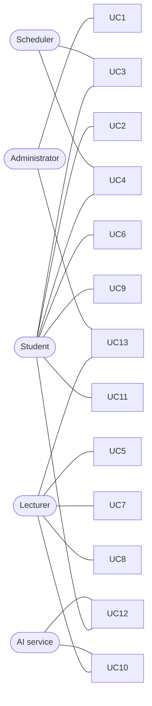

# Main Use Cases (Client Stories)

**Project:** Smart Classroom Web Application
**Version:** 1.0  |  **Date:** 2026-11-09
**Related:** `SRS_Attendance.md` (v2.1). Requirement IDs refer to it.

Items marked **[assumed]** are the team's working assumptions and have not been confirmed.

---

## 1. Actors

| Actor | Who they are |
|-------|--------------|
| Student | Attends the lecture in the classroom or online, from a phone or computer browser |
| Lecturer | Teaches the course; wants attendance with no effort during the lecture |
| Administrator | Sets up courses, lectures, and student lists once per semester; may be the lecturer |
| AI service | An outside service that returns generated text from a file. A system actor: we call it, we do not build it |
| Scheduler | The system's own clock-driven loop that opens and closes sessions and spot checks. A system actor |

## 2. Use case list

| # | Use case | Main actor | Feature | Priority |
|---|----------|------------|---------|----------|
| UC1 | Set up a course and its lectures | Administrator | Attendance | Must |
| UC2 | Register a device | Student | Attendance | Must |
| UC3 | Be marked present automatically in class | Student, Scheduler | Attendance | Must |
| UC4 | Answer a spot check by tap | Student, Scheduler | Attendance | Must |
| UC5 | Follow, export, and correct attendance | Lecturer | Attendance | Must |
| UC6 | Send a comment | Student | Comments | Should |
| UC7 | Read comments and pop one up for the class | Lecturer | Comments | Should |
| UC8 | Run a poll or quiz | Lecturer | Polls | Should |
| UC9 | Vote or answer a quiz | Student | Polls | Should |
| UC10 | Upload a lecture recording and get a summary | Lecturer, AI service | Summary | Should |
| UC11 | Read a summary and download the recording | Student | Summary | Should |
| UC12 | Submit homework and get a review | Student, AI service | Homework | Should |
| UC13 | Manage the homework dataset and view reviews | Lecturer, Administrator | Homework | Should |

---

## 3. Use cases

### UC1: Set up a course and its lectures
- **Actor:** Administrator
- **Goal:** Have a course ready so sessions run by themselves all semester.
- **Precondition:** The administrator is logged in.
- **Main steps:**
  1. The administrator creates a course and optionally changes M, N, and the response window (defaults 4, 3, 60 seconds).
  2. The administrator adds each weekly lecture: day, start time, end time.
  3. For each lecture the administrator sets the classroom location: presses "use my current location" while in the room, adjusts if needed, and chooses the radius.
  4. The administrator imports the student list from a CSV file.
  5. The system confirms how many students were enrolled.
- **Alternatives and failures:**
  - A CSV row is malformed: the whole file is rejected and the row number is shown; nothing is imported.
  - A lecture has no point or radius, or a value out of range: it is rejected.
- **Result:** Sessions will open and close from the timetable with no further action.
- **SRS:** FR-1.1–FR-1.4

### UC2: Register a device
- **Actor:** Student
- **Goal:** Link their phone or computer to their student identity once, so later taps are one step.
- **Precondition:** The student is on a course's student list.
- **Main steps:**
  1. The student opens the page and enters their student ID.
  2. The system checks the ID is enrolled and gives the browser a device token.
  3. The page explains why location is requested and asks for permission once.
- **Alternatives and failures:**
  - The ID is not on any course list: registration is refused.
  - The student already has a device: a new device is refused until the lecturer approves it.
  - The student logs in on a second browser: the first login ends.
  - The student denies location: they continue and will answer by tap (UC4).
- **Result:** The device is bound to the student; all later requests carry the token automatically.
- **SRS:** FR-2.1–FR-2.4, FR-4.10

### UC3: Be marked present automatically in class
- **Actors:** Student (passive), Scheduler
- **Goal:** Attendance is recorded for a student in the classroom without them doing anything.
- **Precondition:** The student is registered, allowed location, and has the student page open during the lecture.
- **Main steps:**
  1. At the lecture start the Scheduler opens the session. It picks M hidden random times.
  2. At each time the Scheduler opens a spot check for the response window and the page is alerted.
  3. The student's page reads the device location and sends it.
  4. The server confirms the token, enrollment, open window, and that the location is inside the lecture's radius.
  5. The server records the answer as "location" with the distance. The student sees a short confirmation.
  6. At the lecture end the Scheduler closes the session and the system computes each student's status (UC5).
- **Alternatives and failures:**
  - The location is outside the radius, or cannot be read in time: nothing is recorded and the tap button appears (UC4).
  - The page is closed or the phone is locked: that check is missed.
  - A second answer to the same check is rejected.
- **Result:** The check counts toward N of M with no tap.
- **SRS:** FR-3.1, FR-4.1–FR-4.8, NFR-6, NFR-7

### UC4: Answer a spot check by tap
- **Actors:** Student, Scheduler
- **Goal:** Confirm presence with one tap. Used by online students, students who denied location, and students whose location did not match.
- **Precondition:** The student is registered and has the page open.
- **Main steps:**
  1. The Scheduler opens a spot check and the page shows a large "I'm here" button.
  2. The student taps it before the window ends.
  3. The server validates the token, enrollment, and open window, and records the answer as "tap".
  4. The page shows a confirmation.
- **Alternatives and failures:**
  - The window has ended: the answer is rejected and the page says so.
  - The student taps twice: the second is rejected.
  - The page was closed: the check is missed and the page says so when it is reopened.
- **Result:** The check counts toward N of M.
- **SRS:** FR-4.3–FR-4.6, FR-4.9, NFR-2

### UC5: Follow, export, and correct attendance
- **Actor:** Lecturer
- **Goal:** See who attended, take the data away, and fix mistakes.
- **Precondition:** At least one session exists.
- **Main steps:**
  1. During or after a session the lecturer opens the dashboard and sees each student's answered / total, how each check was answered, and the status. The table updates live.
  2. After the session closes the status is final: Present (at least N of M), Partial, Absent, or Flagged for device conflicts.
  3. The lecturer exports a session or the whole course as CSV.
  4. To correct a status, the lecturer overrides it and types a reason.
- **Alternatives and failures:**
  - The lecturer cancels a session (a holiday): it never opens and is left out of percentages.
- **Result:** The lecturer has an up-to-date spreadsheet. The original computed status stays visible next to any override.
- **SRS:** FR-3.2, FR-5.1, FR-5.2, FR-6.1–FR-6.4

### UC6: Send a comment
- **Actor:** Student
- **Goal:** Tell the lecturer a question, remark, or suggestion.
- **Precondition:** The student is registered and enrolled.
- **Main steps:**
  1. The student types up to 500 characters in the comment box and sends it.
  2. The system stores it, linked to the open session if one exists.
  3. The student sees that it was sent.
- **Alternatives and failures:**
  - Empty or too long: rejected with a message.
  - No session is open: the comment is stored and reaches the lecturer's comment list. **[assumed]** This is what "offline" means here: the lecturer does not need to be online.
- **Result:** The lecturer can read the comment (UC7).
- **SRS:** FR-7.1–FR-7.3

### UC7: Read comments and pop one up for the class
- **Actor:** Lecturer
- **Goal:** React to what students say, and share a good question with everyone.
- **Main steps:**
  1. During a session, comments appear on the dashboard within 2 seconds, with the student's name and time.
  2. The lecturer picks a comment and presses "pop up".
  3. Every connected student page shows the comment text without the author's name.
  4. The lecturer dismisses it, or it disappears when the session closes.
- **Alternatives and failures:**
  - Between sessions the lecturer reads the stored list instead.
- **Result:** The class sees the chosen comment and the lecturer stays in control of the screen.
- **SRS:** FR-7.2, FR-7.4, FR-7.6, FR-7.7

### UC8: Run a poll or quiz
- **Actor:** Lecturer
- **Goal:** Ask the class a question about the current material and see the answers live.
- **Precondition:** A session is open.
- **Main steps:**
  1. The lecturer types a question and 2 to 6 options. Optionally the lecturer marks one option correct, which makes it a quiz.
  2. The poll opens at once on every connected student page.
  3. Live counts per option are shown to the lecturer, without voter names.
  4. The lecturer closes the poll. Students see the results; in a quiz each student also sees the correct answer and whether they were right.
- **Alternatives and failures:**
  - Fewer than 2 or more than 6 options: rejected.
  - The session ends first: the poll closes with it.
  - In a quiz the correct answer is never sent to students before it closes.
- **Result:** The lecturer knows how well the material landed. No scores are saved.
- **SRS:** FR-8.1–FR-8.8

### UC9: Vote or answer a quiz
- **Actor:** Student
- **Goal:** Answer the lecturer's question with one tap.
- **Precondition:** A poll is open and the student has the page open.
- **Main steps:**
  1. The poll appears on the student page.
  2. The student taps one option and sees that the vote was recorded.
  3. When the poll closes, the student sees the results, and for a quiz whether they were right.
- **Alternatives and failures:**
  - A second vote is rejected.
  - The poll has closed: the vote is rejected.
  - The page was closed: the student misses the poll.
- **SRS:** FR-8.2, FR-8.3, FR-8.6, FR-8.7

### UC10: Upload a lecture recording and get a summary
- **Actors:** Lecturer, AI service
- **Goal:** Give students a written summary of a lecture without writing it by hand.
- **Precondition:** The lecturer has an MP4 file of a lecture.
- **Main steps:**
  1. The lecturer picks the session and uploads the MP4.
  2. The system stores the file and replies at once; the job shows "pending".
  3. In the background the system sends the video to the AI service.
  4. The AI service returns the summary text and the job shows "done".
  5. The summary appears for the lecturer and the course's students (UC11).
- **Alternatives and failures:**
  - Not an MP4, or over the size limit: rejected with a message.
  - The AI service fails or times out: the job shows "failed" with a clear message, the lecturer retries. Attendance, comments, and polls keep working.
  - The server restarts: the pending job runs afterwards.
- **Result:** A stored summary linked to the session.
- **SRS:** FR-9.1–FR-9.5, NFR-8, NFR-9

### UC11: Read a summary and download the recording
- **Actor:** Student
- **Goal:** Catch up on a previous lecture.
- **Precondition:** The student is enrolled and a summary exists.
- **Main steps:**
  1. The student opens the list of previous lectures of the course.
  2. The student opens a lecture and reads its summary.
  3. The student presses the link on the page to download the MP4 recording.
- **Alternatives and failures:**
  - A student not enrolled in the course, or a visitor with the file path, is refused.
  - The summary is not ready or failed: the page says so; the recording link is shown when a recording exists.
- **Result:** The student has the summary and the recording. The recording is download only, with no player in the app. **[assumed]**
- **SRS:** FR-9.4, FR-9.7, FR-9.8, NFR-10

### UC12: Submit homework and get a review
- **Actors:** Student, AI service
- **Goal:** Get detailed feedback on a homework PDF and see how it compares with others, anonymously.
- **Precondition:** The student is enrolled and an assignment exists. Uploading is the student's choice; nobody is required to.
- **Main steps:**
  1. The student picks the assignment and uploads a PDF.
  2. The student chooses whether the PDF may be added to the dataset (default: no).
  3. The system sends the PDF and the assignment's dataset to the AI service in the background; the job shows "pending".
  4. The AI service returns the review: feedback, an anonymous comparison with the dataset, and anonymous examples of work done right where useful.
  5. The review appears on the student's page, and only theirs.
- **Alternatives and failures:**
  - Not a PDF, or over the size limit: rejected.
  - The AI service fails or times out: "failed" with a clear message; the student can retry.
  - The student opted in: the PDF joins the dataset only after its own review finished.
- **Result:** A private review for the student. The student never sees the dataset or any other student's name.
- **SRS:** FR-10.2–FR-10.7, FR-10.10, NFR-11

### UC13: Manage the homework dataset and view reviews
- **Actors:** Lecturer, Administrator
- **Goal:** Prepare what the AI compares against, and see how students did.
- **Main steps:**
  1. The lecturer or administrator creates a homework assignment for a course.
  2. They upload sample solutions and other homework PDFs as the dataset.
  3. Later they see the list of students who uploaded and each student's review, the same text the student sees.
- **Alternatives and failures:**
  - No student can list, open, or download dataset documents.
  - There is no class-wide comparison: the lecturer's view is the same individual reviews.
- **Result:** The dataset is reachable only by the AI service and the lecturer.
- **SRS:** FR-10.1, FR-10.8, FR-10.9

---

## 4. Not use cases (scope notes)
- No student or lecturer account management beyond UC1 and UC2: the lecturer and administrator use one login from environment settings.
- No Zoom, Meet, or Classroom integration: online students use their own video tool; the app only runs the spot checks.
- No push notification when the page is closed.
